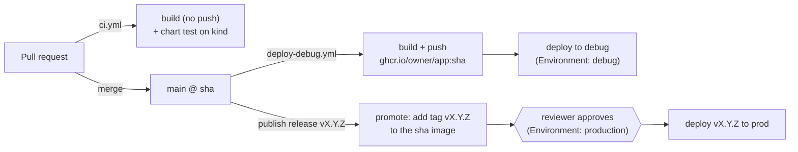

# app-template

GitHub template for a small FastAPI service that ships to EKS with Helm. Create a repo from it,
run one script, set two GitHub Environments, and you get:

- **Pull requests:** image build + Helm chart test on a throwaway kind cluster.
- **Merge to `main`:** image `ghcr.io/<owner>/<app>:<git sha>` is built and deployed to **debug**.
- **Publish a release:** that same image is tagged with the release version and, after a reviewer
  approves, deployed to **prod**. Nothing is rebuilt.

All CI/CD logic lives in [`sockstabby/platform`](https://github.com/sockstabby/platform)'s
reusable workflows, called as `@v1`; this repo only holds thin callers. Fixes to the pipeline reach
every app through the `v1` tag; breaking changes ship as `@v2` and are opt-in. The platform repo
also holds the infrastructure (VPCs, EKS clusters, IAM roles) and the full design write-up.

## Create an app from this template

1. **Use this template** → *Create a new repository* (public, so the reusable workflows and GHCR
   pulls work without extra access settings).
2. Clone it and rename the placeholders (the app name becomes the Helm release, Kubernetes object
   names and image name: lowercase letters, digits and `-`, max 40 chars):
   ```sh
   scripts/init.sh my-service            # owner is read from `git remote`; or pass it as 2nd arg
   git diff                              # chart, Makefile, workflows, README
   git commit -am "Initialise my-service" && git push
   ```
3. **Create two GitHub Environments** (*Settings → Environments*), each with two **variables**
   (not secrets; neither value is sensitive). The values come from the platform's Terraform outputs.

   | Environment | Deployment refs | Protection | `AWS_ROLE_ARN` | `EKS_CLUSTER_NAME` |
   |---|---|---|---|---|
   | `debug` | branch `main` | none | `arn:aws:iam::<account>:role/modern-cloud-stack-debug-deploy` | `modern-cloud-stack-debug` |
   | `production` | tags `v*` | required reviewer(s) | `arn:aws:iam::<account>:role/modern-cloud-stack-prod-deploy` | `modern-cloud-stack-prod` |

   The deploy roles trust any repo of the owner, but only from a job running in the matching
   Environment, so the Environment rules decide who can deploy. No IAM change is needed per app.
   On a one-person account, leave *Prevent self-review* off or nobody can approve.
4. **First merge to `main`** builds and pushes the image, then deploys to debug. GHCR creates new
   packages as **private**, so the first deploy fails to pull and Helm rolls it back. Make the
   package public once (*your profile → Packages → `<app>` → Package settings → Change
   visibility → Public*; this can't be undone), then re-run the failed deploy job.

## Run it locally on kind

Needs Docker, kind, kubectl, Helm 4 and Python 3 (versions in the platform repo's
`.tool-versions`).

```sh
make venv test     # create .venv, run unit tests
make all           # kind-up → build → deploy-local → smoke
make kind-down     # delete the local cluster
```

| Target | Does |
|---|---|
| `make kind-up` | Creates kind cluster `app-template` (node image pinned by digest); no-op if it exists |
| `make build` | `docker build` with `APP_VERSION=<short sha>`, then `kind load docker-image` |
| `make deploy-local` | `helm upgrade --install` with `chart/values-local.yaml` (local image, `pullPolicy: Never`), waits for rollout |
| `make smoke` | Port-forwards the service to `localhost:18080`, expects `/healthz` = 200, prints `/version` |
| `make lint` | `helm lint` the chart with each values file |

The app serves `/` (name and environment), `/healthz` and `/version` (the deployed image tag) on
port 8080 and runs as a non-root user with a read-only root filesystem.

## How code reaches prod



1. **Debug** follows `main`. Every merge builds an image tagged with the commit SHA and deploys
   it with `chart/values-debug.yaml` (1 replica).
2. **Prod** follows releases. Create a release (tag `vX.Y.Z`) from a commit **whose
   `deploy-debug` run has finished**. `deploy-prod.yml` then:
   - adds the tag `vX.Y.Z` to the existing `:<sha>` image in GHCR (a registry-side copy, so the
     digest is identical to what ran on debug);
   - waits for a reviewer to approve the `production` deployment;
   - deploys with `chart/values-prod.yaml` (2 replicas spread across zones, PodDisruptionBudget
     `minAvailable: 1`).
3. Deploys use `helm upgrade --install --rollback-on-failure --wait`: if the new pods don't become
   ready in time, Helm rolls back to the previous release and the job fails.

If you release a commit that was never built on `main` (for example a tag on a feature branch),
the promote step fails with "does not exist" instead of building something untested. Deploys from
other refs are refused by the Environment rules: `debug` accepts only `main`, `production` only
`v*` tags.

**Rolling back prod:** publish a release for an older good commit, or re-run the deploy job of an
earlier release run.

## What's in the repo

```
app/                    # FastAPI app (main.py), tests, pinned requirements
Dockerfile              # multi-stage, python slim, non-root (UID 10001), APP_VERSION build arg
chart/                  # Helm chart: deployment, service, serviceaccount, PDB
  values.yaml           #   defaults (image repo, probes, security context)
  values-local.yaml     #   kind: local image, pullPolicy Never
  values-debug.yaml     #   1 replica, APP_ENV=debug
  values-prod.yaml      #   2 replicas, zone anti-affinity, PDB
Makefile                # local kind loop
scripts/init.sh         # rename placeholders after "Use this template"
.github/workflows/
  ci.yml                # PRs: platform reusable-build (no push) + reusable-chart-test
  deploy-debug.yml      # push to main: reusable-build (push) → reusable-deploy (debug)
  deploy-prod.yml       # release published: reusable-promote → reusable-deploy (production)
```

Each workflow job grants only the permissions it needs: `contents: read` everywhere,
`packages: write` only to push or tag images, `id-token: write` only for the deploy job's OIDC
login to AWS. There are no AWS keys or other secrets in the repo.

Helm's `APP VERSION` column shows `dev` (from `Chart.yaml`); the running version is the image tag,
which `/version` reports.
